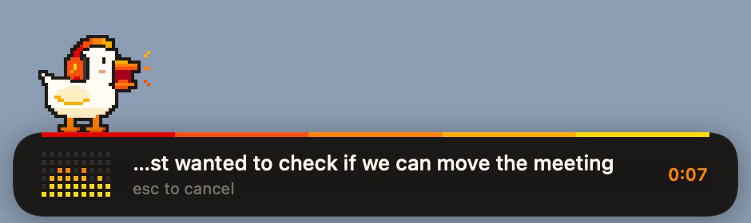

# Le Blab 🦆


A native macOS dictation app inspired by Wispr Flow. Hold a shortcut, talk, let go — your words
land at the cursor of whatever app you're in (Notes, Chrome, Slack, VS Code/Cursor, Mail…),
transcribed by **Mistral Voxtral 3** and optionally cleaned up by **Mistral Small 4**.
A pixel duck in Mistral's colours quacks along while you talk.



## Quick start

```bash
# 1. Build (Command Line Tools are enough; no Xcode project)
scripts/build-app.sh                     # → build/Le Blab.app
# Optional: sign with any local code-signing cert so macOS permissions survive rebuilds
CODESIGN_IDENTITY="Your Cert" scripts/build-app.sh

# 2. Run
open "build/Le Blab.app"
```

On first launch the welcome window walks you through:
1. **Mistral API key** — verified with `GET /v1/models`, stored in the macOS Keychain only.
   (Or: `security add-generic-password -U -s local.leblab.LeBlab -a mistral-api-key -w`.)
2. **Microphone** permission.
3. **Accessibility** permission — needed to insert text and to detect press-and-hold of the
   shortcut. Input Monitoring is *not* required.

Then click into any text field, **hold ⌃⇧ (Control+Shift)**, speak, release.

| Action | Default |
|---|---|
| Dictate | Hold **⌃⇧**, release to insert |
| Cancel | **Esc** while dictating |
| Toggle mode | Settings → General → Activation (press once to start, again to stop; optional auto-stop on silence via Voxtral turn detection) |
| Other shortcuts | Presets: Fn⇧, ⌥Space, Fn, right ⌥, right ⌘ — or record any key combo |

Le Blab never presses Return/Enter for you.

## Features

- **Realtime streaming** to `voxtral-mini-transcribe-realtime-3-0` over Mistral's documented
  WebSocket, with live partials in the overlay.
- **Accuracy mode**: `voxtral-small-transcribe-3-0` transcribes the whole clip on release
  (live preview still streams).
- **Smart formatting** (default) or **raw** mode. Smart mode removes fillers, applies
  self-corrections ("Friday at 3, actually make that 4" → "Friday at 4 PM"), fixes punctuation,
  formats lists, writes spoken URLs/file names properly, keeps your language — with guardrails
  that fall back to the raw transcript if the model answers instead of editing.
- **Custom vocabulary** (CodeRabbit, DevRel, GitHub, Mistral, Voxtral… editable) sent as Voxtral
  `context_bias` *and* applied as conservative post-correction.
- **Automatic language detection** per dictation (English/German tested; 13+ languages pinnable).
- **Text insertion**: Accessibility API for native text views (verified, falls back if the app
  silently ignores it), clipboard paste for browsers/Electron/terminals with full clipboard
  restore, or simulated typing.
- **Resilience**: audio buffered while connecting, reconnect + replay on network drops, batch
  fallback, Retry on failure, transcripts never silently dropped.
- **Diagnostics**: time to first partial, release → final, release → insertion, API time
  (p50/p90), plus a pipeline self-test with synthesized speech.
- **Privacy**: no audio files, history off by default, Keychain-only key, no telemetry, EU/US
  regional endpoints selectable, explicit disclosure of what goes to Mistral.

## Measured latency

Live against the Mistral API on an M4 Max (see [docs/ARCHITECTURE.md](docs/ARCHITECTURE.md#latency-design-measured-not-assumed)):

| | Typical |
|---|---|
| Key press → first partial on screen | ~1.0 s (480 ms streaming delay) |
| Release → final transcript | ~0.6 s |
| Release → text inserted, raw mode | ~0.7 s |
| Release → text inserted, smart formatting | ~1.2 s |

## Privacy in one paragraph

Audio is captured only while the shortcut is held, kept in memory, streamed over TLS to Mistral,
and zeroed after each dictation — Le Blab never writes audio to disk. Transcripts stay in memory
unless you enable local history (off by default, 0600 file, excluded from backups, auto-pruned).
**Mistral processes your audio remotely**; per Mistral's privacy policy API inputs/outputs are
retained for 30 days for abuse monitoring unless your organisation has Zero Data Retention.
Training controls are separate from retention. Voxtral Mini Transcribe Realtime 3 is a
**Public Preview** model, which Mistral's terms treat differently. Details and links:
[docs/PRIVACY.md](docs/PRIVACY.md) and Settings → Privacy.

## Project layout

```
Sources/LeBlabCore/   model-agnostic core (unit-tested): audio, Voxtral clients, session,
                      formatter, insertion, hotkeys, settings, privacy, diagnostics, duck sprite
Sources/LeBlab/       SwiftUI/AppKit app: menu bar, overlay, settings, onboarding, self-test
Sources/leblab-probe/ CLI that drives the real transcription/formatting code against the API
Tests/LeBlabCoreTests 77 tests (Swift Testing) with fake sockets/transcribers/inserters
scripts/              build-app.sh, test.sh, e2e-selftest.sh
docs/                 ARCHITECTURE.md, PRIVACY.md, MANUAL_TEST_CHECKLIST.md
```

## Development

```bash
scripts/test.sh                                   # unit tests (works with Command Line Tools)
MISTRAL_API_KEY=… .build/debug/leblab-probe models
MISTRAL_API_KEY=… .build/debug/leblab-probe realtime speech.aiff --trace
MISTRAL_API_KEY=… .build/debug/leblab-probe format "um ship it tuesday no wait wednesday"
scripts/e2e-selftest.sh textedit                  # full app pipeline into a throwaway TextEdit doc
scripts/e2e-selftest.sh chrome "Some phrase"      # paste path + clipboard-restore check
```

The self-test speaks a phrase with macOS's synthesizer *in memory*, streams it through the real
app (Voxtral → formatter → insertion), reads the field back via Accessibility, and checks the
clipboard is unchanged. It refuses to run unless the expected app is frontmost. For test runs
only, the key may be passed via `MISTRAL_API_KEY` (so rebuilt dev binaries don't trigger Keychain
prompts); normal launches read the Keychain only.

Swapping in a local speech model: implement `StreamingTranscriber` / `BatchTranscriber`
(`Sources/LeBlabCore/Transcription/SpeechTranscription.swift`) — see the architecture doc.
